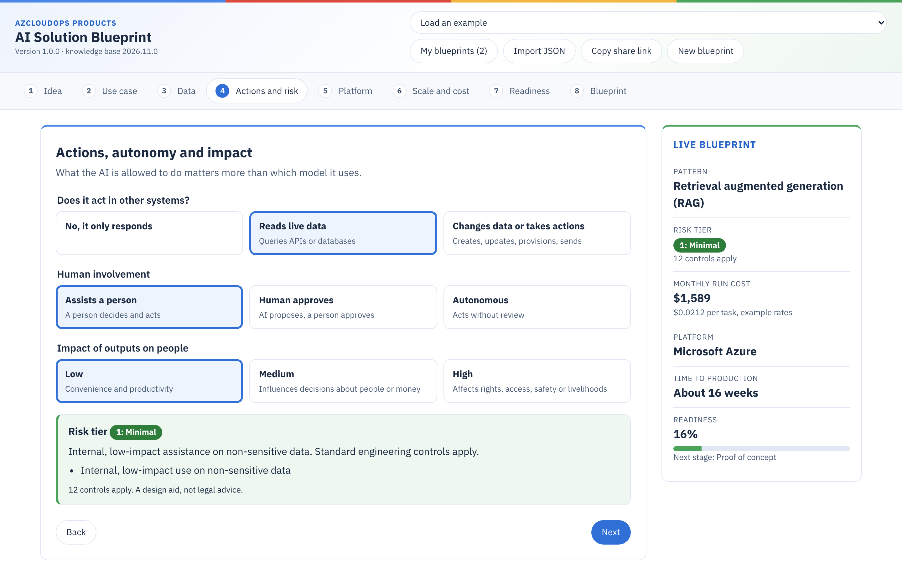

# AI Solution Blueprint

Design an enterprise AI solution from idea to production in one guided session.

AI Solution Blueprint is a free, open-source tool from [azCloudOps](https://azcloudops.org) for architects, platform engineers, IT leaders and makers. Answer eight short steps and get a complete, shareable design:

| Step | What you get |
|---|---|
| 1. Idea | Owner, problem, success metric and value hypothesis on one page |
| 2. Use case | A recommended solution pattern (prompted model, RAG, agent, multi-agent, fine-tuned, predictive ML) with the reasons and alternatives |
| 3. Data | Sensitivity, freshness, volume and residency captured as design inputs |
| 4. Actions and risk | A risk tier (1 to 4) and the governance controls that apply, mapped to NIST AI RMF, OWASP Top 10 for LLM Applications, the EU AI Act and ISO/IEC 42001 |
| 5. Platform | A reference architecture mapped to current Azure, AWS, Google Cloud or portable services, with a diagram |
| 6. Scale and cost | A monthly run-cost estimate, cost per task and FinOps guardrails |
| 7. Readiness | A stage-gated production readiness checklist and score |
| 8. Blueprint | Export as Markdown, JSON, SVG diagram, Mermaid or PDF |



Private by design: the tool runs entirely on your device, in the browser, the mobile app or the terminal. No accounts, no tracking, nothing sent to any server.

## Use it

### On your phone or tablet

AI Solution Blueprint is coming to Google Play and the App Store (native Android, iPhone and iPad apps built from this repository; see [docs/MOBILE.md](docs/MOBILE.md)). Until then, open the web app on your phone and choose "Add to Home Screen" or "Install app": it installs like an app and works offline.

### In the browser

Open the hosted version at **https://azcloudops.github.io/ai-solution-blueprint/** or on the azCloudOps site under Products.

Or download `ai-solution-blueprint.html` from the [latest release](https://github.com/azcloudops/ai-solution-blueprint/releases/latest) and open it locally. It is one self-contained file and works offline.

### From the command line

Requires Node.js 20 or later.

```bash
# Run without installing
npx github:azcloudops/ai-solution-blueprint new

# Or install globally from GitHub
npm install -g github:azcloudops/ai-solution-blueprint
aiblueprint new
```

| Command | Purpose |
|---|---|
| `aiblueprint new [--out dir]` | Guided questions, then writes `blueprint.md`, `answers.json`, `architecture.svg`, `architecture.mmd` |
| `aiblueprint render answers.json [--out dir]` | Regenerate the blueprint from saved answers (ideal in CI or pull requests) |
| `aiblueprint validate answers.json` | Check an answers file |
| `aiblueprint example helpdesk\|access\|claims` | Write an example answers file to start from |
| `aiblueprint web [--out file]` | Write the self-contained web app to a single HTML file |
| `aiblueprint kb [--list]` | Show the knowledge base version and the service names flagged for verification |

Answers files are plain JSON, so you can keep them in Git next to the solution, review changes in pull requests, and regenerate the blueprint whenever the knowledge base updates.

### As a library

```js
import { buildBlueprint, toMarkdown } from "@azcloudops/ai-solution-blueprint";
import kb from "@azcloudops/ai-solution-blueprint/kb" with { type: "json" };

const bp = buildBlueprint({ useCase: "knowledge-qa", platform: "aws" }, kb);
console.log(toMarkdown(bp));
```

## How it works

```
kb/knowledge-base.json   Patterns, cloud service maps, controls, metrics, readiness gates (versioned monthly)
src/engine.js            Pure functions shared by the web app and CLI
web/                     Web app source (template, styles, app, service worker, fonts)
scripts/build.mjs        Builds the web app (PWA), the single-file release and the native app bundle
mobile/                  Capacitor 8 shell for the Google Play and App Store apps
assets/                  Icon and splash sources
bin/aiblueprint.js       Zero-dependency CLI
examples/                Example answers files
```

The recommendation logic is transparent and rule based. Every recommendation shows its reasons, and every cloud service name carries a verification flag until a maintainer has checked it against the provider's documentation for that release.

## Releases

A new version ships on the **first Tuesday of every month** with an updated knowledge base (service names, new controls, new patterns) and new features. Fixes ship as patch releases whenever needed. See [ROADMAP.md](ROADMAP.md) and [CHANGELOG.md](CHANGELOG.md).

## Important

The blueprint is a design aid. The risk tier is not legal advice, and cost estimates use example placeholder rates until you enter your contracted prices. Always confirm service availability, regional support and regulatory classification with the provider and your legal, security and risk teams.

## Contributing

Corrections to the knowledge base are the most valuable contribution: a renamed service, a new control, a better metric. See [CONTRIBUTING.md](CONTRIBUTING.md).

## License

MIT. Built and maintained by Manoj Annavajjala and the azCloudOps community.
